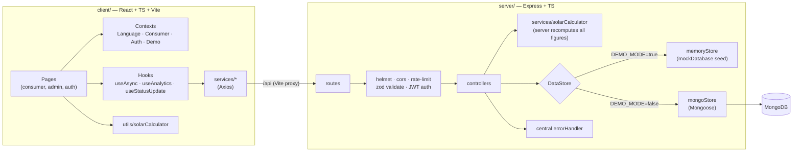
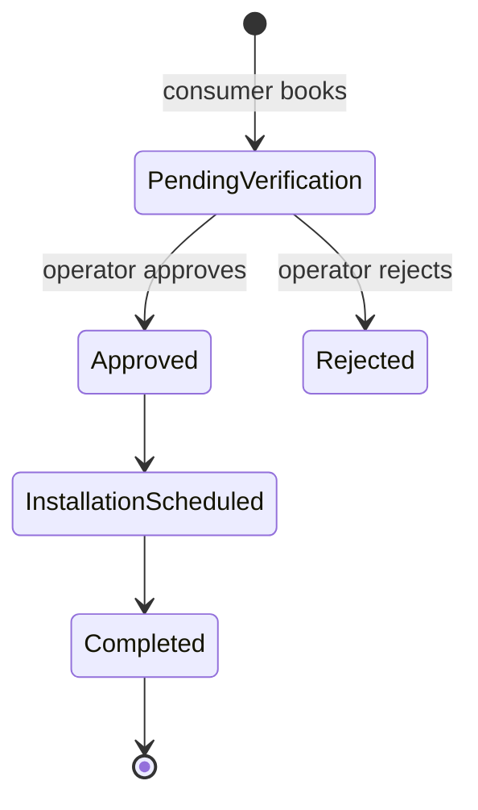

# ☀️ SolarMitra — *Your Solar Friend*

> **SANKALP by Satin Finserv — The Climate Edition** · Theme: *Sustainable Cities & Rural Energy Transition*

**Tagline:** *Your roof can power your future.*

SolarMitra helps households find out whether rooftop solar makes sense for them, understand the subsidies they may get, compare paying upfront with a Satin Finserv green loan, and book a verified installer. All of it happens in one mobile-first, multilingual flow. Operators get a dashboard to verify leads and track climate impact across the portfolio.

---

## 1. The problem

Rural and semi-urban households spend a large share of their income on electricity. Rooftop solar with government subsidies can cut that bill sharply, but most families never get started because:

| Barrier | What it looks like |
| --- | --- |
| **Information** | "How big a system do I need? What does it cost?" |
| **Subsidy confusion** | Central and state schemes, eligibility, paperwork |
| **Upfront cost** | ₹1–2 lakh is out of reach even after subsidy |
| **Trust** | "Which installer is genuine?" |
| **Language & digital literacy** | Most tools are English-only and full of jargon |

## 2. The solution

A guided eight-stage flow goes from **electricity details → personal & KYC → property → solar preferences → solar plan → financing → verified installer → review & tracking**:

1. **Pick a language**: English, हिंदी, ગુજરાતી, தமிழ் (saved on the device)
2. **Enter electricity details**: choose simulated bill OCR or enter units, state, and bill manually
3. **Add personal and property details**: review each stage separately; progress is saved on the device
4. **Explore a solar plan**: compare neighboring system sizes with configured costs, central/state support, contribution, savings, and environmental estimates
5. **Choose payment terms**: compare upfront payment with 12-, 24-, and 36-month illustrative financing
6. **Select an installer and submit**: review the application and required consents before submission
7. **Track the application**: see its privacy-safe status timeline; operators can review application details in the admin console

**Operators** (lender / field agents) get a *Clean Energy Transition Dashboard* with KPIs, charts, lead verification (approve/reject), vendor management and a climate-impact view.

---

## 3. Quick start

**Requirements:** Node.js ≥ 18.18 (tested on Node 22), npm. **No MongoDB and no API keys needed.**

```bash
npm install      # installs root, server and client (via postinstall)
npm run dev      # starts API (:5000) + web app (:5173) together
```

Then open **http://localhost:5173**.

| URL | What |
| --- | --- |
| http://localhost:5173/ | Landing page |
| http://localhost:5173/consumer | Consumer app (mobile-first; shown in a phone frame on desktop) |
| http://localhost:5173/admin/login | Operator console |
| http://localhost:5000/api/health | API health check |

### Demo credentials

| Role | Email | Password |
| --- | --- | --- |
| Admin | `admin@solarmitra.demo` | `demo123` |

The login page also has a **"Use demo credentials"** button. The consumer `/login` page simulates phone OTP; use **`123456`**.

> These credentials only exist in the seeded demo data. Change or remove them before any real deployment.

---

## 4. Demo mode vs MongoDB

| `DEMO_MODE` | Behaviour |
| --- | --- |
| `true` *(default)* | Seeded in-memory data (3 Kanpur vendors, 10 leads across UP/GJ/TN/RJ/MH, analytics). Nothing to install. The admin header shows a subtle **Demo Mode** badge. Data resets when the server restarts or from **Settings → Reset demo data**. |
| `false` | Uses MongoDB via Mongoose. If MongoDB can't be reached, the API logs the reason and **falls back to demo data** so a live demo never breaks (`/api/health` then reports `database: "fallback-demo"`). |

### Using MongoDB

```bash
docker compose up -d                 # starts mongo:7 on :27017 (or use a local/Atlas instance)
cp server/.env.example server/.env   # then set DEMO_MODE=false and a real JWT_SECRET
npm run seed                         # idempotent: safe to run repeatedly
npm run dev
```

### Environment variables

**`server/.env`** (copy from `server/.env.example`)

| Variable | Default | Notes |
| --- | --- | --- |
| `PORT` | `5000` | API port |
| `MONGO_URI` | `mongodb://localhost:27017/solarmitra` | Only used when `DEMO_MODE=false` |
| `JWT_SECRET` | `change_this_secret` | **Required** when `DEMO_MODE=false`. In demo mode an ephemeral secret is generated if it's unset (admin sessions then end when the server restarts). |
| `DEMO_MODE` | `true` | See above |
| `CLIENT_URL` | `http://localhost:5173` | CORS allow-list (comma separated) |

**`client/.env`** (copy from `client/.env.example`, optional)

| Variable | Default | Notes |
| --- | --- | --- |
| `VITE_API_URL` | `/api` | `/api` goes through the Vite dev proxy to `:5000` (works on localhost, LAN phones and tunnels). You can also set `http://localhost:5000/api`. |
| `VITE_DEMO_MODE` | `true` | If the API is unreachable, the consumer flow keeps working with bundled demo vendors and a local application ID |

No secrets are committed. `.env` files are git-ignored.

---

## 5. Demo values and checks

Run with the default `DEMO_MODE=true` setting; MongoDB and API keys are not needed. The consumer journey starts with synthetic values already filled in, so you can press **Continue** through the stages without entering test data.

| Field | Default demo value |
| --- | --- |
| Electricity | Uttar Pradesh · 350 kWh/month · ₹2,800/month |
| Consumer / DISCOM | `DEMO-0001` · Demo DISCOM |
| Personal | Demo Household · `9876543210` · `demo@example.test` · `1990-01-01` |
| KYC | Other accepted ID · `DEMO-ID-001` (demo collection only) |
| Property | Demo Solar Street, Kanpur · Uttar Pradesh · `208001` |
| Solar | 3 kW recommended · battery No · financing · 36 months |
| Installer | First active vendor for Uttar Pradesh (selected after the installer list loads) |

The values are editable. At the final review, tick both consent boxes to enable submission. If you switch the KYC type to Aadhaar or PAN, enter a synthetic test value in the expected format; never use a real identity number. No KYC number or selected document/photo file is sent to the API. Bill OCR remains simulated.

For a full run: start with `npm run dev`, visit <http://localhost:5173/>, continue through all eight stages, submit, check the status from **Track My Application**, then open <http://localhost:5173/admin/login> and use **Use demo credentials** to inspect and update the application. **Settings → Reset demo data** clears the current run. In-memory application data also resets when the server restarts.

Run `npm test` and `npm run build` from the repository root to check the calculator/API tests and both production builds. The public tracking endpoint returns only the privacy-safe status view; application journey details are available only through authenticated admin routes. DOB is excluded from the browser draft and masked by default in admin.

---

## 6. Architecture



**Application lifecycle**



**Design choices**

- **Server is the source of truth.** On `POST /api/applications` the API recomputes kW, cost, subsidy, EMI and CO₂ from the submitted units, state and loan terms, so figures from the client can't be tampered with.
- **Same calculator on both sides.** `solarCalculator.ts` runs in the client (instant UI) and the server (validation), with the same tests.
- **One `DataStore` interface.** Memory and Mongo implementations are interchangeable, so demo mode is not a separate code path in the controllers.
- **UI components don't make API calls.** They go through `services/*` and hooks. Admin pages are lazy-loaded.

---

## 7. API

All responses use `{ "success": true, "data": … }` or `{ "success": false, "message": "…" }`.
🔒 = requires `Authorization: Bearer <JWT>` (admin/agent).

| Method | Path | Description |
| --- | --- | --- |
| GET | `/api/health` | Status, demo mode, database mode |
| POST | `/api/auth/login` | `{email,password}` → `{token,user}` (rate-limited) |
| GET | `/api/auth/me` 🔒 | Current operator |
| GET | `/api/vendors?state=&search=&active=` | Vendors (sorted by distance) |
| GET | `/api/vendors/:id` | Vendor details |
| PATCH | `/api/vendors/:id/active` 🔒 | Enable/disable a vendor |
| POST | `/api/audits` | `{state,monthlyUnits,monthlyBill?}` → audit, recommendation, climate impact |
| GET | `/api/audits/:id` | Saved audit |
| POST | `/api/applications` | Create application (figures recomputed server-side) |
| GET | `/api/applications/:id/track` | Public, privacy-safe status for the consumer tracker |
| GET | `/api/applications` 🔒 | Paginated list (`search,state,status,sort,order,page,limit`) |
| GET | `/api/applications/:id` 🔒 | Full application incl. vendor |
| PATCH | `/api/applications/:id/status` 🔒 | `{status, note?}` |
| GET | `/api/leads` 🔒 | Lead view of applications (same filters) |
| PATCH | `/api/leads/:id/status` 🔒 | Approve / reject / advance |
| GET | `/api/analytics/overview` 🔒 | KPIs, change %, pipeline, trees estimate, methodology |
| GET | `/api/analytics/monthly` 🔒 | Jan–Sep installations, CO₂, loans |
| GET | `/api/analytics/regional` 🔒 | 5-state breakdown |
| POST | `/api/demo/reset` 🔒 | Reset demo data (admin) |

---

## 8. Calculation assumptions

> **Demo Policy Assumptions — For Hackathon Simulation.** All values live in one place: `server/src/config/policyConfig.ts` (mirrored in `client/src/utils/policyConfig.ts`).

| Item | Rule |
| --- | --- |
| System size | `kW = round(monthly units ÷ 120)`, min 1, max 10 (0 units → no recommendation) |
| System cost | 1 kW ₹60,000 · 2 kW ₹1,10,000 · 3 kW ₹1,65,000 · +₹50,000 per kW above 3 |
| Central subsidy | 1 kW ₹30,000 · 2 kW ₹60,000 · ≥3 kW ₹78,000 (capped) |
| State top-up | Uttar Pradesh ₹30,000 · Gujarat ₹20,000 · Tamil Nadu ₹15,000 · other states ₹0 |
| Net cost | cost − subsidies (never below 0) |
| Monthly savings | bill × min(1, generation ÷ consumption); missing bill → units × ₹8 |
| EMI | standard reducing-balance formula; demo 7.5% p.a., 36 months |
| Affordability | EMI ÷ current bill: ≤ 0.7 Comfortable · ≤ 1 Moderate · > 1 High |
| CO₂ | annual kWh × **0.7 kg/kWh** (demo grid emission factor) |
| Trees | CO₂ kg ÷ 21 kg per tree per year (labelled as an estimate) |

> **Policy disclaimer:** Subsidy values shown are for demonstration purposes only. Actual eligibility and subsidy amounts depend on current government policies, location, DISCOM approval, and applicable scheme guidelines.
>
> **Financial disclaimer:** Illustrative financing calculation. Final loan eligibility, interest rate, tenure, subsidy eligibility, and repayment terms are subject to applicable policies and lender approval.

The app handles edge cases: 0 or very large units, a missing bill, unsupported states, loan amount 0 (upfront), invalid phone numbers, an unreachable API/MongoDB, expired JWTs (redirects to login) and empty lead lists. It never shows `NaN` or `Infinity`.

---

## 9. Project structure

```
.
├── package.json            # npm run dev / build / test / seed / typecheck
├── docker-compose.yml      # optional MongoDB
├── server/
│   └── src/
│       ├── config/         # env, database, policyConfig
│       ├── data/           # mockDatabase (seed data), seed.ts
│       ├── models/         # User, Lead, Vendor, Application, Loan, SolarAudit
│       ├── services/       # solarCalculator, analytics, auth, DataStore (memory | mongo)
│       ├── validators/     # zod schemas
│       ├── middleware/     # auth, validate, rateLimit, errorHandler
│       └── controllers/  routes/  utils/
│   └── tests/              # calculator + API tests (vitest + supertest)
└── client/
    └── src/
        ├── pages/          # Landing, consumer/*, admin/*, auth/*
        ├── layouts/        # ConsumerLayout (phone frame), AdminLayout (sidebar)
        ├── components/     # ui/ (shadcn-style), consumer/, admin/, charts/, shared/
        ├── context/        # Language, Consumer (persisted), Auth, Demo
        ├── hooks/  services/  utils/  types/  data/
        └── i18n/           # translations: en · hi · gu · ta
```

## 10. Scripts

| Command | What it does |
| --- | --- |
| `npm run dev` | API + web app with hot reload |
| `npm run build` | Production build of client (`client/dist`) and server (`server/dist`) |
| `npm test` | Server (calculator + API validation) and client (calculator) tests |
| `npm run typecheck` | Strict TypeScript for both packages |
| `npm run seed` | Seed MongoDB (idempotent) |

## 11. Tech stack

**Client:** React 18, TypeScript, Vite, React Router, Tailwind CSS, shadcn-style UI primitives (no extra UI kit), Lucide icons, Framer Motion, Recharts, React Hook Form + Zod, Axios, self-hosted Noto/Plus Jakarta fonts (renders offline).
**Server:** Node.js, Express, TypeScript, Mongoose, JWT, bcrypt, Zod, Helmet, CORS, express-rate-limit, dotenv.

---

<sub>Figures, vendors, applicants and policies in this demo are simulated for the hackathon and are not official scheme data.</sub>
