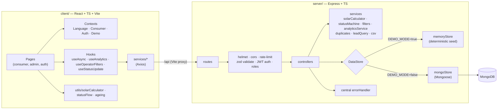
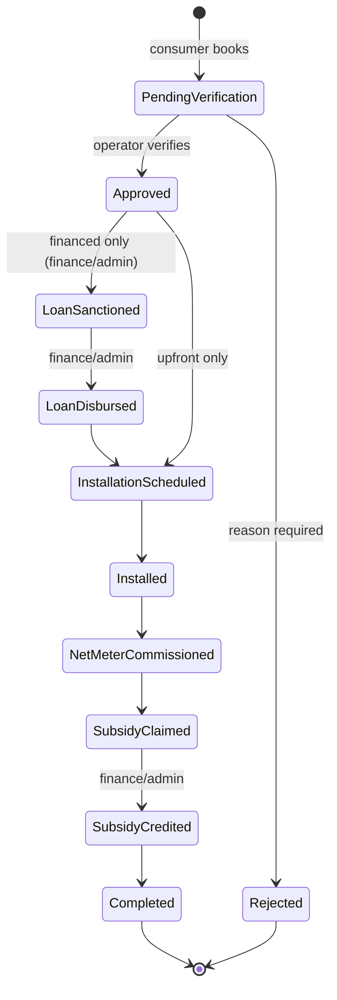

# ☀️ SolarMitra — *Your Solar Friend*

> **SANKALP by Satin Finserv — The Climate Edition** · Theme: *Sustainable Cities & Rural Energy Transition*

**Tagline:** *Your roof can power your future.*

SolarMitra helps households find out whether rooftop solar makes sense for them, understand the subsidies they may get, compare paying upfront with a Satin Finserv green loan, and book a verified installer — in one mobile-first, multilingual flow. Operators (lender, field agents, finance desk) get a dashboard that traces every file and every rupee from the first solar audit to the subsidy credited to the household.

---

## 1. The problem

Rural and semi-urban households spend a large share of their income on electricity. Rooftop solar with government subsidies can cut that bill sharply, but most families never get started because:

| Barrier | What it looks like |
| --- | --- |
| **Information** | "How big a system do I need? What does it cost?" |
| **Subsidy confusion** | Central and state schemes, eligibility, paperwork |
| **Upfront cost** | ₹1–2 lakh is out of reach even after subsidy |
| **Trust** | "Which installer is genuine?" |
| **Language & digital literacy** | Most tools are English-only and full of jargon |

## 2. The solution

**For households:** electricity bill → solar plan → subsidy → affordable EMI → verified installer → tracked application.

1. **Pick a language**: English, हिंदी, ગુજરાતી, தமிழ் (saved on the device)
2. **Upload a bill**: simulated OCR fills state, units and bill amount; every value stays editable
3. **See the plan**: recommended kW, system cost, central + state subsidy, net cost, monthly savings
4. **Trace the subsidy**: every rupee is shown against the named central/state scheme it comes from
5. **Choose how to pay**: upfront, or a Satin Finserv EMI compared side by side with today's bill, plus an EMI simulator
6. **Pick a partner**: nearby MNRE-empanelled, verified installers
7. **Book & apply**: get an application ID (`SM-2026-XXXX`) and a live status tracker

**For operators:** one console where the same filters drive every KPI, chart, table and CSV export — so the numbers can never disagree.

- **Dashboard** — climate, finance, subsidy and queue KPIs with period-over-period change, impact story, funnel and charts
- **Leads / Applications** — filterable pipeline with SLA ageing, duplicate warnings, assignment, and role-aware next actions
- **Money flow** — ledger of every sanction, disbursement, EMI, subsidy movement and vendor payout, plus CSV export
- **Vendors** — enable/disable partners, see empanelment status
- **Climate impact** — all 36 states/UTs, monthly series, CO₂ avoided with a labelled methodology
- **Settings** — reset the demo, inspect the dataset

### Operator roles (enforced by the API, mirrored in the UI)

| Role | Can do | Cannot do |
| --- | --- | --- |
| **Admin** | Everything: approve/reject, assign leads, sanction/disburse, record transactions, reset demo | — |
| **Agent** | Verify/approve/reject **only files assigned to them**, claim unassigned files ("Assign to me") | Sanction/disburse loans, credit subsidy, record transactions, reset demo |
| **Finance** | Sanction loans, disburse, credit subsidy, record EMI/repayment transactions | Approve/reject leads, reset demo |

---

## 3. Quick start

**Requirements:** Node.js ≥ 18.18 (tested on Node 22), npm. **No MongoDB and no API keys needed.**

```bash
npm install      # installs root, server and client (via postinstall)
npm run dev      # starts API (:5000) + web app (:5173) together
```

Then open **http://localhost:5173**.

| URL | What |
| --- | --- |
| http://localhost:5173/ | Landing page |
| http://localhost:5173/consumer | Consumer app (mobile-first; shown in a phone frame on desktop) |
| http://localhost:5173/admin/login | Operator console |
| http://localhost:5000/api/health | API health check |

### Demo credentials

| Role | Email | Password | Seeded persona |
| --- | --- | --- | --- |
| Admin | `admin@solarmitra.demo` | `demo123` | Demo Operator |
| Agent | `agent@solarmitra.demo` | `agent123` | Priya Nair (field agent) |
| Finance | `finance@solarmitra.demo` | `finance123` | Ravi Menon (finance desk) |

The login page has a **"Use demo credentials"** button for each role. The consumer `/login` page simulates phone OTP; use **`123456`**.

> These credentials only exist in the seeded demo data. Change or remove them before any real deployment.

---

## 4. Demo mode vs MongoDB

| `DEMO_MODE` | Behaviour |
| --- | --- |
| `true` *(default)* | Deterministic in-memory dataset — nothing to install. The admin header shows a subtle **Demo Mode** badge. Data resets when the server restarts or from **Settings → Reset demo data**. |
| `false` | Uses MongoDB via Mongoose. If MongoDB can't be reached, the API logs the reason and **falls back to demo data** so a live demo never breaks (`/api/health` then reports `database: "fallback-demo"`). |

**What the demo dataset contains** (deterministic, generated from seed `20260101`, window **1 Jan → 26 Sep 2026**):

| Records | Count | Notes |
| --- | --- | --- |
| Applications | **1,260** (10 handwritten story leads + 1,250 generated) | spread over UP, GJ, TN, RJ, MH, KA, WB, MP, HR, PB, BR + more; ~54% financed |
| Solar audits | **1,900** | every application is preceded by its own audit; the rest never converted |
| Transactions | **~3,570** | loan sanctions/disbursements, EMIs (with DPD), subsidy claimed/credited, upfront payments, vendor payouts |
| Vendors | **39** | 3 handwritten Kanpur partners + 36 generated (one per state/UT, some inactive) |
| Schemes | **33** | central + state catalogue, version `2026.09-demo.1`, every entry labelled a demo assumption |

### Using MongoDB

```bash
docker compose up -d                 # starts mongo:7 on :27017 (or use a local/Atlas instance)
cp server/.env.example server/.env   # then set DEMO_MODE=false and a real JWT_SECRET
npm run seed                         # idempotent: safe to run repeatedly
npm run dev
```

### Environment variables

**`server/.env`** (copy from `server/.env.example`)

| Variable | Default | Notes |
| --- | --- | --- |
| `PORT` | `5000` | API port |
| `MONGO_URI` | `mongodb://localhost:27017/solarmitra` | Only used when `DEMO_MODE=false` |
| `JWT_SECRET` | `change_this_secret` | **Required** when `DEMO_MODE=false`. In demo mode an ephemeral secret is generated if unset (admin sessions then end when the server restarts). |
| `DEMO_MODE` | `true` | See above |
| `CLIENT_URL` | `http://localhost:5173` | CORS allow-list (comma separated) |
| `ADMIN_EMAIL` / `ADMIN_PASSWORD` | demo values | Optional overrides for the seeded admin |

**`client/.env`** (copy from `client/.env.example`, optional)

| Variable | Default | Notes |
| --- | --- | --- |
| `VITE_API_URL` | `/api` | Keep `/api`: the browser calls its own origin and Vite proxies to `:5000`, which works on localhost, LAN phones and tunnelled preview URLs. |
| `VITE_DEMO_MODE` | `true` | If the API is unreachable, the consumer flow keeps working with bundled demo vendors and a local application ID |

No secrets are committed. `.env` files are git-ignored.

---

## 5. Five-minute demo script

1. **Landing** → *Start My Solar Audit*
2. **Language** → choose **हिंदी** (the whole consumer flow switches; change it any time from the top bar)
3. **Onboarding** → 3 short steps (Next / Back / Skip)
4. **Audit** → *Upload bill* → the simulated OCR reads **Uttar Pradesh · 350 kWh · ₹2,800** (labelled *Demo OCR Data*)
5. **Subsidy** → **3 kW** · ₹1,65,000 − ₹78,000 central − ₹30,000 state (UP top-up) = **₹57,000** · saves ~₹2,800/month. The **scheme stack** below lists *PM Surya Ghar: Muft Bijli Yojana* and *UP Rooftop Solar Top-up* — tap a chip to see its slabs, eligibility and how the money is disbursed.
6. **Financing** → toggle *Upfront* / *Satin Finserv EMI* → **₹57,000 @ 7.5% × 36 months ≈ ₹1,773/month**. The chart compares ₹2,800 today, ~₹1,773 EMI and ₹0 after the loan. Try the EMI simulator sliders.
7. **Vendors** → verified partners near Kanpur → *View details* → *Select* → fill in name/phone → **Book Installation & Apply for Loan**
8. **Success** → confetti, application ID, timeline → *Track My Application* (public, privacy-safe status endpoint)
9. **Operator console** → `/admin/login` → *Use demo credentials* (admin) → **Dashboard**
10. **Dashboard** (default period = last 30 days, data as of **26 Sept 2026**):
    - Cumulative: **579 systems live · 1.64 MW · 1,651 t CO₂ avoided (≈78,600 trees) · ₹4.53 Cr disbursed · ₹2.06 Cr subsidy credited**
    - Period: **₹76.3 L disbursed · 84.8% EMIs on time · 7.6% at 30+ DPD · 90 files pending, oldest 10d 10h, 54 past the 48h SLA**
    - **Funnel** (monotonic, applications touched in the period): audits 708 → applications 605 → approved 500 → installed 279 → commissioned 208 → subsidy credited 70, with the financed loan branch shown underneath (217 of 353 disbursed)
11. **Filter bar** → pick **State: Uttar Pradesh**, **Scheme: up-rts-topup**, **Payment: Financed**. Every KPI, chart, the funnel, the tables and the CSV exports re-query the same filter — and the URL carries the slice, so you can share or reload it.
12. **Leads** → your new application is at the top with a **New** badge → **Assign to me** → **Approve**. Watch the dashboard KPIs and the consumer tracker follow. Then sign in as `finance@solarmitra.demo` and **Sanction → Disburse** the same file: the agent role cannot do this (the API answers 403/409), the money-flow ledger shows the disbursement.
13. **Money flow** → filter by *Loan Disbursed*, export the CSV, open an application and see its money trail and repayment health.
14. **Settings → Reset demo data** restores everything for the next run.

---

## 6. Architecture



**Application lifecycle** (enforced by the API, mirrored in the console and the consumer tracker):



Files waiting in *Pending Verification* show a **48-hour SLA** badge; anything older turns red in the queue health card, the lead table and the CSV export.

**Design choices**

- **Server is the source of truth.** `POST /api/applications` recomputes kW, cost, subsidy, EMI and CO₂ from the submitted units, state and loan terms, so figures from the client can't be tampered with. Every status change is re-validated (illegal move → `409`, wrong role → `403`) and written to the timeline with the operator's name.
- **One filter object, one truth.** The lead list, transactions, analytics, funnel and CSV exports all consume the same validated filter contract (`state/district/discom/scheme/status/vendor/paymentMode/from/to/search`), so a KPI and the rows underneath it always agree.
- **Analytics are aggregated, never hard-coded.** Systems live = files that reached net-meter commissioning; sanctioned ≠ disbursed; subsidy claimed ≠ credited; savings accrue from the commissioning month.
- **Same pure modules on both sides.** `solarCalculator`, `statusFlow` and `ageing` are byte-identical mirrors (a server test fails if they drift).
- **One `DataStore` interface.** Memory and Mongo implementations are interchangeable, so demo mode is not a separate code path in the controllers.
- **UI components don't make API calls.** They go through `services/*` and hooks. Admin pages are lazy-loaded.

---

## 7. API

All responses use `{ "success": true, "data": … }` or `{ "success": false, "message": "…" }`.
🔒 = `Authorization: Bearer <JWT>`. Operator routes accept **admin, agent and finance**; row-level rules apply on top.

| Method | Path | Description |
| --- | --- | --- |
| GET | `/api/health` | Status, demo mode, database mode |
| POST | `/api/auth/login` | `{email,password}` → `{token,user}` (rate-limited; consumer role denied) |
| GET | `/api/auth/me` 🔒 | Current operator |
| GET | `/api/users` 🔒 | Operators available for lead assignment |
| GET | `/api/vendors?state=&district=&search=&active=` | Vendors (sorted by distance) |
| GET | `/api/vendors/:id` | Vendor details |
| PATCH | `/api/vendors/:id/active` 🔒 | Enable/disable a vendor |
| GET | `/api/schemes?state=&level=&category=` | Subsidy catalogue (versioned, labelled demo assumptions) |
| GET | `/api/schemes/:id` | One scheme |
| POST | `/api/audits` | `{state,monthlyUnits,monthlyBill?}` → audit + recommendation |
| GET | `/api/audits/:id` | Saved audit |
| POST | `/api/applications` | Create application (figures recomputed server-side, duplicates flagged) |
| GET | `/api/applications/duplicates?phone=&consumerNumber=` | Duplicate check |
| GET | `/api/applications/:id/track` | Public, privacy-safe status for the consumer tracker |
| GET | `/api/applications` 🔒 | Paginated list (agents: unassigned + own) |
| GET | `/api/applications/export.csv` 🔒 | CSV of the filtered rows |
| GET | `/api/applications/:id` 🔒 | Full application incl. vendor, ageing, duplicates |
| PATCH | `/api/applications/:id/status` 🔒 | `{status, note?, reason?}` — state machine rules apply |
| PATCH | `/api/applications/:id/assign` 🔒 | `{userId}` / `{userId:null}` / `{assignToMe:true}` |
| GET | `/api/leads` 🔒 | Lead pipeline view (same filters, sorting, pagination) |
| GET | `/api/leads/export.csv` 🔒 | CSV incl. waiting time and SLA columns |
| PATCH | `/api/leads/:id/status` 🔒 | Approve / reject / advance |
| PATCH | `/api/leads/:id/assign` 🔒 | Assign or claim |
| GET | `/api/transactions?kind=&from=&to=&page=` 🔒 | Money ledger with totals for the filtered slice |
| POST | `/api/transactions` 🔒 | Record a transaction (admin/finance only) |
| GET | `/api/transactions/export.csv` 🔒 | CSV of the filtered ledger |
| GET | `/api/analytics/overview` 🔒 | KPIs, change %, funnel, loan branch, pipeline, money flow |
| GET | `/api/analytics/monthly` 🔒 | Monthly installations, capacity, CO₂, loans, subsidy |
| GET | `/api/analytics/regional` 🔒 | All 36 states/UTs (zeros included) |
| GET | `/api/analytics/funnel` 🔒 | Milestone funnel on its own |
| GET | `/api/analytics/money-flow` 🔒 | Money in/out by kind and by month |
| POST | `/api/demo/reset` 🔒 | Reset demo data (admin only) |

Every list/analytics/export route accepts the same filter query: `state, district, discom, scheme, status, vendor, paymentMode, assignedTo, search, from, to, preset` (comma-separated lists welcome).

---

## 8. Calculation assumptions

> **Demo Policy Assumptions — For Hackathon Simulation.** All values live in one place: `server/src/config/policyConfig.ts` (mirrored in `client/src/utils/policyConfig.ts`).

| Item | Rule |
| --- | --- |
| System size | `kW = round(monthly units ÷ 120)`, min 1, max 10 (0 units → no recommendation) |
| System cost | 1 kW ₹60,000 · 2 kW ₹1,10,000 · 3 kW ₹1,65,000 · +₹50,000 per kW above 3 |
| Central subsidy | 1 kW ₹30,000 · 2 kW ₹60,000 · ≥3 kW ₹78,000 (capped) |
| State top-up | Uttar Pradesh ₹30,000 · Gujarat ₹20,000 · Tamil Nadu ₹15,000 · other states ₹0 |
| Net cost | cost − subsidies (never below 0) |
| Monthly savings | bill × min(1, generation ÷ consumption); missing bill → units × ₹8 |
| EMI | standard reducing-balance formula; demo 7.5% p.a., 36 months |
| Affordability | EMI ÷ current bill: ≤ 0.7 Comfortable · ≤ 1 Moderate · > 1 High |
| CO₂ | annual kWh × **0.7 kg/kWh** (demo grid emission factor) |
| Trees | CO₂ kg ÷ 21 kg per tree per year (labelled as an estimate) |
| SLA | 48 hours in *Pending Verification* before a file is flagged |

> **Policy disclaimer:** Subsidy values shown are for demonstration purposes only. Actual eligibility and subsidy amounts depend on current government policies, location, DISCOM approval, and applicable scheme guidelines.
>
> **Financial disclaimer:** Illustrative financing calculation. Final loan eligibility, interest rate, tenure, subsidy eligibility, and repayment terms are subject to applicable policies and lender approval.

The app handles edge cases: 0 or very large units, a missing bill, unsupported states, loan amount 0 (upfront), invalid phone numbers, an unreachable API/MongoDB, expired JWTs (redirects to login), empty lead lists, duplicated phone/consumer numbers and out-of-order status attempts. It never shows `NaN` or `Infinity`.

---

## 9. Tests

```bash
npm test              # everything
npm --prefix server test   # 111 API + domain tests (vitest + supertest)
npm --prefix client test   # 20 unit tests (calculator, filters, status/journey)
npm run typecheck          # strict TS for both packages
```

Server coverage highlights: the 11-status state machine (illegal jumps → 409, wrong role → 403, rejection reasons mandatory), role scoping for agents and finance, filter/CSV consistency, analytics aggregation (`approved ≠ disbursed`, monotonic funnel, all-36-region output, no `NaN` anywhere), duplicate detection, ageing/SLA, scheme catalogue integrity and the byte-identical mirrors.

---

## 10. Project structure

```
.
├── package.json            # npm run dev / build / test / seed / typecheck
├── docker-compose.yml      # optional MongoDB
├── server/
│   └── src/
│       ├── config/         # env, database, policyConfig, statusFlow, subsidySchemes
│       ├── data/           # indiaRegions, historicalSeed, mockDatabase, seed
│       ├── models/         # User, Lead, Vendor, Application, Transaction, SolarAudit
│       ├── services/       # solarCalculator, statusMachine, filters, analyticsService,
│       │                   # leadQuery, duplicates, csv, auth, DataStore (memory | mongo)
│       ├── validators/     # zod schemas for every endpoint
│       ├── middleware/     # auth, validate, rateLimit, errorHandler
│       └── controllers/  routes/  utils/
│   └── tests/              # API + domain tests (vitest + supertest)
└── client/
    └── src/
        ├── pages/          # Landing, consumer/*, admin/*, auth/*
        ├── layouts/        # ConsumerLayout (phone frame), AdminLayout (sidebar)
        ├── components/     # ui/ (shadcn-style), consumer/, admin/ (FilterBar, LeadsManager,
        │                   # StatusBadge, SchemeChips, KpiCard), charts/, shared/
        ├── context/        # Language, Consumer (persisted), Auth, Demo
        ├── hooks/          # useAsync, useAnalytics, useOperatorFilters, useStatusUpdate…
        ├── services/       # thin Axios wrappers per domain
        └── utils/  types/  data/  i18n/
```

## 11. Scripts

| Command | What it does |
| --- | --- |
| `npm run dev` | API + web app with hot reload |
| `npm run build` | Production build of client (`client/dist`) and server (`server/dist`) |
| `npm test` | Server (API + domain) and client (unit) tests |
| `npm run typecheck` | Strict TypeScript for both packages |
| `npm run seed` | Seed MongoDB (idempotent) |

## 12. Tech stack

**Client:** React 18, TypeScript, Vite, React Router, Tailwind CSS, shadcn-style UI primitives (no extra UI kit), Lucide icons, Framer Motion, Recharts, React Hook Form + Zod, Axios, self-hosted Noto/Plus Jakarta fonts (renders offline).
**Server:** Node.js, Express, TypeScript, Mongoose, JWT, bcrypt, Zod, Helmet, CORS, express-rate-limit, dotenv.

---

<sub>Figures, vendors, applicants and policies in this demo are simulated for the hackathon and are not official scheme data.</sub>
